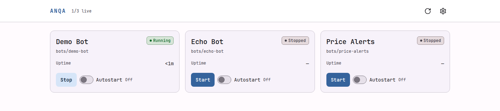

# Anqa

[](https://github.com/benyamin-git/Anqa/actions/workflows/ci.yml)
[](https://github.com/benyamin-git/Anqa/pkgs/container/anqa)

Anqa is a self-hosted dashboard for running Telegram bots as one Docker
container per bot. Point it at a directory of bot projects, then start, stop,
and autostart them from one page.

> Early software (v0.1.1). The API and manifest format may change before 1.0.

> **Anqa controls Docker.** It talks directly to `/var/run/docker.sock`, which
> is equivalent to root access on the host. Run it on a trusted network, put it
> behind HTTPS before exposing it, and only add bot code you trust. Mounting the
> socket read-only does not make the Docker API read-only.

## Screenshots

### Desktop



Light theme with sample data. The live bot shows its uptime and a Stop control;
stopped bots offer Start. Each card has its own autostart switch.

## Install

### Docker Compose

You need Linux, Docker Engine, the Compose plugin, and permission to use the
Docker socket. The image supports `linux/amd64` and `linux/arm64`.

```sh
git clone https://github.com/benyamin-git/Anqa.git
cd Anqa
cp .env.example .env
```

Set `ANQA_UID` and `ANQA_GID` to the user that should own `./data`, and
`DOCKER_GID` to the group that owns the Docker socket. On a typical Linux host:

```sh
sed -i "s/^ANQA_UID=.*/ANQA_UID=$(id -u)/" .env
sed -i "s/^ANQA_GID=.*/ANQA_GID=$(id -g)/" .env
sed -i "s/^DOCKER_GID=.*/DOCKER_GID=$(stat -c '%g' /var/run/docker.sock)/" .env
```

Create the two host directories and start the pinned image:

```sh
mkdir -p bots data
docker compose up -d
cat data/token
```

Open `http://<host>:7409` and paste the token. The token is also printed once
to `docker compose logs anqa` when it is first generated.

The Compose service runs the dashboard as `ANQA_UID:ANQA_GID`, adds
`DOCKER_GID`, and mounts the bots directory read-only. The Docker socket stays
read-only at the mount level, but requests through the Docker API still have
full control of the daemon.

### Add the example bot

```sh
cp -r examples/echo-bot bots/echo-bot
cp bots/echo-bot/.env.example bots/echo-bot/.env
$EDITOR bots/echo-bot/.env
```

Put the token from [@BotFather](https://t.me/BotFather) in
`TELEGRAM_BOT_TOKEN`. The dashboard discovers the directory on its next poll.
Press **Start**; Anqa builds the Dockerfile and starts the container. See
[`examples/echo-bot/README.md`](examples/echo-bot/README.md) for the bot itself.

## What it does

- Lists every top-level directory in `/bots` that contains a `Dockerfile` or a
  `bot.toml`, with its display name, directory, status, Docker health, uptime,
  and last operation error.
- Builds Dockerfile bots on Start with BuildKit and Docker layer caching.
  Prebuilt images are pulled only when the image is missing locally.
- Starts and stops exactly one managed container per bot.
- Toggles Docker restart policy between `always` and `no` for autostart.
- Creates named Docker volumes declared in `bot.toml`; keeps those volumes when
  a bot is rebuilt, recreated, or removed. Volumes are never deleted by Anqa.
- Removes managed containers for bot directories that have disappeared, while
  keeping their volumes.
- Serves a terminal-style dashboard with Light, Dark, and OLED themes, Telegram
  blue and Rust orange accents, keyboard controls, and a 2-second status poll.
- Requires one token. The token is stored in `data/token`, sent in an
  HttpOnly/SameSite=Strict cookie, and can also be sent as a Bearer token.

## Bot directory contract

The bots directory is mounted read-only at `/bots`. Each immediate child
directory is a bot:

- A directory with a `Dockerfile` is built from that Dockerfile.
- A directory with a `bot.toml` can name a prebuilt image instead.
- Having both a Dockerfile and `image` in `bot.toml` is an error.
- Hidden entries and symlinks are ignored.
- A malformed `bot.toml` appears as an error card; it does not hide other bots.
- The directory name becomes the slug used for the container, image tag, and
  volume names. It must fit Docker's 63-byte name limit after slugifying.

Files are read when the dashboard scans. A bot directory deleted from the host
is removed from the dashboard; its container is cleaned up on the next Anqa
startup, and its named volumes remain.

### Build context

Dockerfile builds use the bot directory as the context. Anqa honours a
`.dockerignore` in that directory. `.env` files, `.git` directories, and the
`.dockerignore` file itself are always kept out of the uploaded build context.
The environment is injected into the container at run time, not baked into the
image.

The image tag is `anqa/<slug>:latest`. Start always rebuilds a Dockerfile bot;
Docker's cache decides how much actually runs again. Changes to code, the
Dockerfile, or the manifest are picked up on the next Start.

## Manifest reference

`bot.toml` is optional when a Dockerfile exists. Unknown fields are errors.

```toml
name = "Echo Bot"                 # optional display name
image = "ghcr.io/example/bot:v1"  # mutually exclusive with a Dockerfile
env_file = ".env"                 # optional; defaults to .env if it exists
command = ["python", "-u", "bot.py"]
ports = ["8080:8080", "127.0.0.1:9000:9000/udp"]
volumes = ["data:/data"]
```

| Field | Type | Rules |
| --- | --- | --- |
| `name` | string | Optional display name. Defaults to the directory name. |
| `image` | string | Prebuilt image. Cannot be used with a Dockerfile. |
| `env_file` | string | Relative path, no `..`. Defaults to `.env` when present. A missing explicit file is an error. |
| `command` | string array | Optional argv override for the container. Empty arrays are invalid. |
| `ports` | string array | `host:container`, `ip:host:container`, with an optional `/tcp` or `/udp` suffix. Both ports must be non-zero. Duplicate host ports or container targets are errors. |
| `volumes` | string array | `name:/absolute/path`. Named volumes only; host bind mounts are rejected. Duplicate names or targets are errors. |

Named volumes created by Anqa are called `anqa-<slug>-<name>` and carry the
`anqa.managed=true` and `anqa.bot=<directory>` labels. Anqa creates them as
needed and never removes them.

### Environment files

`env_file` uses `KEY=value` syntax and is read at every scan. Values are passed
to the container as environment variables. The file is not copied into the
image, and `.env` is ignored by the build context. Keep secrets out of source
control.

## Autostart

Autostart is a Docker restart policy, not a separate scheduler. Turning it on
sets the bot container's policy to `always`; turning it off sets it to `no`.

- Turning autostart on for a bot that has never started builds or pulls the
  image and creates its container without starting it. Press **Start** once if
  you want the bot to run immediately.
- Docker applies restart policies to containers it has started. A daemon or
  host restart brings back a bot that was started with autostart on.
- **Stop** stops the container now, but with autostart on, Docker may start it
  again after a daemon or host restart. Turn autostart off if the bot should
  stay down.
- There is no Restart button. Stop the bot, then Start it.

## Data, backups, and cleanup

Anqa keeps two files in `data/`:

- `data/token`: the dashboard token, mode `0600`.
- `data/.anqa-volume`: a sentinel containing the bots root's device and inode.

The sentinel protects against mounting a missing or replacement bots volume and
deleting every managed container. On the first run with a new bots root, Anqa
writes the sentinel and skips orphan cleanup for that run. On later runs it
removes managed containers whose directory has disappeared. If the bots mount
changes, the sentinel no longer matches and cleanup is skipped again.

Bot data is in Docker named volumes, not in the bots directory. To back up one:

```sh
mkdir -p backups
docker run --rm \
  -v anqa-echo-bot-data:/source:ro \
  -v "$PWD/backups":/backup \
  alpine:3.22 tar czf /backup/echo-bot-data.tar.gz -C /source .
```

Replace the volume name with the one from `docker volume ls --filter
label=anqa.managed=true`. Stop the bot first if its files need a consistent
snapshot. Restore with the reverse command before starting the bot. Copy
`data/` separately; `data/token` is a secret.

## API

All `/api` routes except login require the session cookie or a Bearer token.
Errors use `{"error":{"code":"...","message":"..."}}`. Mutations return `202
Accepted` and finish in the background; refresh `GET /api/bots` or watch the
card for `busy` and `error`.

| Method | Path | Auth | Purpose |
| --- | --- | --- | --- |
| `POST` | `/api/login` | Public | Body `{"token":"..."}`. Sets the `anqa_session` cookie. |
| `POST` | `/api/logout` | Required | Clears the browser cookie. |
| `GET` | `/api/bots` | Required | Returns `{"bots":[...]}` with each bot's status and controls. |
| `POST` | `/api/bots/{dir}/start` | Required | Builds/pulls if needed, then starts the container. |
| `POST` | `/api/bots/{dir}/stop` | Required | Stops the container. |
| `PUT` | `/api/bots/{dir}/autostart` | Required | Body `{"enabled":true}` or `{"enabled":false}`. |
| `GET` | `/healthz` | Public | Returns Anqa's own health and version. |

Example:

```sh
curl -fsS -H "Authorization: Bearer $(cat data/token)" \
  http://127.0.0.1:7409/api/bots
```

A bot view has `dir`, `name`, `status`, `health`, `uptime_seconds`,
`autostart`, `busy`, `error`, `image`, `ports`, and `volumes`. `status` is one
of `running`, `stopped`, `starting`, `restarting`, `unhealthy`, `error`,
`building`, or `stopping`.

Sessions are stateless. Logging out clears the browser cookie but does not
revoke a copied cookie; rotate the token to invalidate all sessions.

## Deployment

The expected host layout is:

```text
/srv/stacks/anqa/
  compose.yaml
  .env
  bots/
    echo-bot/
  data/
    token
```

Run `docker compose up -d` from that directory. Anqa listens on
`0.0.0.0:7409` by default. Put a TLS reverse proxy in front of it before
exposing it outside a trusted network, then set `ANQA_SECURE_COOKIE=1` in
`.env` so the session cookie carries the `Secure` flag.

The dashboard image is pinned in `compose.yaml`. To update, change the tag,
then run `docker compose pull && docker compose up -d`. To roll back, pin the
previous tag and run the same command. Named bot volumes are unaffected by
dashboard image changes.

Anqa does not manage host firewall rules, TLS certificates, or a reverse
proxy. It also does not add resource limits, networks, or extra privileges to
bot containers; those follow the bot image and Docker defaults.

## Development

The project uses Rust 1.98.1 and Docker. The binary is a single Rust executable
with embedded static assets.

```sh
cargo fmt --check
cargo clippy --all-targets -- -D warnings
cargo test
```

Real-Docker integration tests are serial and create uniquely named resources:

```sh
ANQA_REQUIRE_DOCKER=1 cargo test --test docker_integration -- --test-threads=1
```

Without `ANQA_REQUIRE_DOCKER=1`, tests that need Docker skip with a message.
The orphan-cleanup test also skips when it finds an existing managed container,
so it cannot remove unrelated bots.

Run the local source build with the standalone dev Compose file:

```sh
cp .env.example .env
mkdir -p dev-bots dev-data
docker compose -f compose.dev.yaml up -d --build
cat dev-data/token
```

The dev stack uses `dev-bots/` and `dev-data/` and publishes port 7409. The
module map and screenshot instructions are in [`AGENTS.md`](AGENTS.md).

## Token rotation

The token is read from `data/token` unless `ANQA_TOKEN` is set. To rotate it:

```sh
rm data/token
docker compose restart anqa
cat data/token
```

Or set a fixed `ANQA_TOKEN` in `.env` and recreate the service. Rotation
invalidates existing cookies and Bearer tokens. Store backups of `data/token`
as securely as the token itself.

## Troubleshooting

- **Login says the token is invalid** — read `data/token`, or check
  `docker compose logs anqa` for the one-time generated token. The startup
  message appears only when the token is created.
- **Docker unavailable banner** — check that the host Docker daemon is
  running, that the socket exists, and that `DOCKER_GID` matches
  `stat -c '%g' /var/run/docker.sock`. The dashboard still serves its login
  page and retries on later requests.
- **Permission denied writing data** — set `ANQA_UID` and `ANQA_GID` to the
  owner of `data/`, or fix the directory ownership on the host.
- **Build fails** — the error is on the bot card. Build the directory manually
  with `docker build` to see the full log; Anqa v0.1.1 does not stream build
  logs to the UI.
- **Autostart did not run the bot** — press Start once after enabling
  autostart, and confirm the container policy with
  `docker inspect anqa-<slug> --format '{{.HostConfig.RestartPolicy.Name}}'`.
- **Port already in use** — change `ANQA_PORT` in `.env`; Compose maps the same
  port on the host and inside the container.
- **Deleted bot still has a container** — restart Anqa to run orphan cleanup,
  then check that the old named volume is still present for recovery.

## Known limitations

Anqa v0.1.1 deliberately does not:

- show or persist bot logs, or stream build logs in the browser;
- create, edit, rename, or delete bot directories from the UI;
- restart with one button (Stop, then Start);
- probe Telegram or check that a bot token is valid; health comes only from
  Docker;
- manage multiple users, roles, or per-user permissions;
- run a Compose project per bot, detect frameworks, or install dependencies;
- configure Docker networks, resource limits, CPU/memory limits, or extra
  labels;
- manage private-registry credentials; pulls use the Docker daemon's existing
  configuration;
- use host bind mounts for bot data, or remove named volumes automatically;
- pull a newer prebuilt image automatically when the tag already exists
  locally;
- provide ARMv7 or native Windows/macOS builds.

Bot containers are not sandboxed beyond Docker's own defaults. Anqa does not
mount the Docker socket into bot containers, but it does run whatever image or
Dockerfile the bot directory defines. Treat bot directories as trusted code.

## License

MIT. See [`LICENSE`](LICENSE).

Telegram is a trademark of Telegram FZ-LLC. Anqa is an independent project and
is not affiliated with or endorsed by Telegram.
